# 🛸 UFO – Unified Fraud Observer

> **Production-Grade 5-Layer Agentic Real-Time Fraud Prevention & Scam Resolution System for UPI**  
> **“Stopping scams before they happen — Deterministic Software on the `<50ms` Critical Path + Probabilistic AI Agents Wrapped in Hard Deterministic Guardrails.”**

---

## 🚨 The Problem

UPI processes **500M+ daily transactions** in India, and fraud is rapidly evolving due to:
- **Social Engineering & Coercion:** Fake "Digital Arrest" video calls (CBI/Customs/Police impersonation), urgent electricity bill disconnection threats, and fake bank KYC suspension alerts.
- **Deceptive UPI Flows:** Collect/Pull requests and QR codes disguised as *receiving* money on OLX/marketplaces.
- **Remote Screen-Sharing Attacks:** Fraudsters convincing victims to install AnyDesk/TeamViewer/RustDesk.
- **Fake Screenshot Receipts:** Fraudsters sending photoshopped payment receipts with fabricated 12-digit UTR numbers to trick merchants/users into issuing "refunds".

⚠️ **Why Naive AI Prototypes Fail at UPI Scale:**
Calling a single monolithic LLM on the live payment path (`Prompt -> LLM -> Output`) takes **3.5+ seconds** (violating UPI's `<150ms` UX SLA), leaks raw **Aadhaar/Phone/Bank A/C PII** to cloud providers (violating RBI rules), explodes cloud token budgets during festival spikes, and is vulnerable to **Prompt Injection** hidden inside fake receipts.

---

## 💡 The UFO Solution (V4 Production-Grade 5-Layer Architecture)

**UFO (Unified Fraud Observer)** solves latency, privacy, cost, and hallucination risk through a **5-Layer Hybrid Deterministic + Agentic System**:

```mermaid
flowchart LR
    Client(["📱 Android App / UPI Client"]) -->|"Sync HTTP (<150ms SLA)"| L1["1️⃣ Layer 1: API Gateway & Rule Engine<br/>• Sliding-Window Velocity & Burst Check<br/>• 301+ I4C Suspect VPA Blacklist<br/>• Zero-Day Deceptive Handle Regex<br/>• Fast Tabular ML (<1ms)"]
    L1 -->|"95% Safe (<5ms) or Hard Block"| Client
    L1 -->|"5% Anomaly / Dispute<br/>Non-Blocking Async Queue"| L2["2️⃣ Layer 2: Privacy & OCR Shield<br/>• Reversible HMAC PII Token Vault<br/>• Edge OCR Prompt Injection Sanitizer"]
    L2 --> L3_Cache["3.1 Semantic Cache<br/>⚡ <10ms Template Match"]
    L3_Cache -->|"Cache Miss"| L3_Router["3.2 Complexity Router<br/>Evaluates Amount, UTR, OCR & Intent"]
    L3_Router -->|"80% Routine Traffic"| L3_SLM["3.3 Small Quantized Model (SLM)<br/>Groq Llama-3.1-8B / QLoRA Qwen2.5-3B"]
    L3_Router -->|"20% Complex Disputes"| L3_LLM["3.4 Frontier LLM + RBI RAG<br/>Gemini 2.5 + RBI Circular 2017-18/15"]
    L3_Cache & L3_SLM & L3_LLM -->|"Strict JSON Schema<br/>Capped at Max 3 Loops"| L5_Guard["5️⃣ Layer 5: Deterministic Policy Guardrail<br/>🛑 Hard ₹5,000 Auto-Refund Cap<br/>🛑 NPCI Switch UTR Verification<br/>🛑 Confidence >= 0.75 Check"]
    L5_Guard -->|"Verified & <= ₹5,000"| L4["4️⃣ Layer 4: NPCI & Bank Core Tools<br/>• Idempotent NPCI UDIR Lien Freeze<br/>• Idempotent Instant Auto-Refund"]
    L5_Guard -->|"> ₹5,000 / Low Conf / 504 Timeout"| HITL["🛡️ HITL & Dead Letter Queue<br/>Human Compliance Officer Review"]
```



---

## 🧠 Core Intelligence & 5 Architectural Layers

### 1️⃣ Layer 1: API Gateway, Velocity Engine & Fast Tabular ML (`<50ms` Sync Path)
- **Rule #1 of Cloud Cost & Latency:** *95% of traffic never touches an LLM.*
- **301+ Fraudster UPI Blacklist (`hall_of_shame`):** Pre-seeded with 301 fraudulent UPI IDs across 7 Indian Cybercrime (MHA I4C / 1930) scam categories + zero-day deceptive handle regex (`cbi.*`, `kyc.*`, `ebill.*`, `anydesk.*`, `indianarmy.*`).
- **Sliding-Window Velocity Tracker:** Detects rapid burst transfers (`>3 txns in 60s`), structuring just below `₹5,000`, and money-mule fan-in (`>=5 distinct payers in 5m`).
- **Behavioral & Contextual Signals:** Evaluates new receiver status, high amount (`>₹3,000`), rushed confirmation, late-night window (`22:00–05:00`), active voice calls, active screen-sharing (AnyDesk/TeamViewer), deceptive Collect Requests, copy-pasted VPAs, and SIM/device changes.
- **Fast Tabular ML Scorer:** Runs in `<1ms` using calibrated ensemble weights (`fraud_model_weights.json`, `93.7%` accuracy, `87.2%` recall) and `scikit-learn` `RandomForestClassifier` (`fraud_model.pkl`).

### 2️⃣ Layer 2: Edge OCR Masking & Reversible PII Token Vault (RBI Compliant)
- **Zero Raw PII to Cloud:** Masks Aadhaar, Mobile Numbers, Bank Account Numbers, PAN, IFSC, and UPI IDs into reversible HMAC-SHA256 tokens (`<AADHAAR_TOKEN_...>`, `<PHONE_TOKEN_...>`, `<UPI_VPA_TOKEN_...>`) before any model sees the prompt.
- **Resilience #1 — Prompt Injection Shield:** Strips adversarial commands (`IGNORE ALL PREVIOUS INSTRUCTIONS...`) embedded inside fake payment screenshot OCR.

### 3️⃣ Layer 3: Unpacked Fraud Investigation Agent Core (85% Cost Reduction)
- **3.1 Semantic Cache (`<10ms`):** Matches recurring scam templates in `<10ms` using SHA-256 hash + n-gram cosine similarity with **0 LLM tokens**.
- **3.2 Complexity Router:** Routes **80% routine checks** to the **Small Quantized Model (SLM)** and **20% complex disputes** to the **Frontier LLM + RBI RAG**.
- **3.3 Small Quantized Model (SLM):** Powered by Groq (`llama-3.1-8b-instant`), local Ollama (`qwen2.5:3b-instruct-q4_K_M`), or custom 4-bit QLoRA fine-tuned weights.
- **3.4 Frontier LLM + RBI Regulatory RAG:** Grounds **Google Gemini (`gemini-2.5-flash`)** in **RBI Circular `RBI/2017-18/15` (Zero/Limited Liability & Shadow Reversal)**, **NPCI UDIR Lien rules**, and **MHA 1930 Golden Hour SOPs**.

### 4️⃣ Layer 4: NPCI & Bank Core Tools (Idempotent Execution)
- Enforces strict JSON schemas and SHA-256 `idempotency_key` deduplication for:
  - `verify_utr_in_ledger`: Cross-verifies 12-digit UTR numbers in `npci_ledger` to block fake receipt scams.
  - `place_npci_lien`: Freezes scammer funds in the beneficiary bank (`LIEN-NPCI-...`).
  - `execute_auto_refund`: Issues instant provisional credit (`RFD-NPCI-...`).

### 5️⃣ Layer 5: Resilience, Guardrails, Async Queue & HITL/DLQ
- **Non-Blocking Async Event Queue:** Decouples `<150ms` user HTTP responses from background Agent Core investigations.
- **Resilience #2 — Token Budget Circuit Breaker:** Hard cap of **max 3 reasoning loops** per request + global 60-second festival-spike token governor.
- **Resilience #3 — Deterministic Policy Guardrail:** Hard non-LLM rule sitting *after* the Agent that **strictly blocks auto-refunds exceeding `₹5,000`** (placing an immediate NPCI Lien and escalating the `>₹5,000` refund to HITL) and blocks unverified UTR receipts.
- **Resilience #4 — HITL & Dead Letter Queue (DLQ):** Captures low-confidence verdicts (`<0.75`), `>₹5,000` refunds, and **NPCI/Bank `504` Gateway Timeouts** for human compliance sign-off.

---

## 🛠️ Tech Stack

| Layer | Technologies Used |
| :--- | :--- |
| **Frontend (Mobile)** | Kotlin (Android), Jetpack Compose, Retrofit2 / OkHttp3 |
| **Backend API & Concurrency** | Python 3.12, FastAPI, Uvicorn, Pydantic v2, HTTPX, Async `ThreadPoolExecutor` Queue |
| **Layer 1 Fast ML & Rules** | Scikit-Learn (`RandomForestClassifier`), Joblib, NumPy, Pandas, Sliding-Window Deque Velocity Engine |
| **Layer 2 Privacy & Security** | HMAC-SHA256 Reversible PII Token Vault (`hmac`, `hashlib`), Regex OCR Prompt Injection Sanitizer |
| **Layer 3 Agentic AI & RAG** | Google Gemini (`gemini-2.5-flash`), Groq SLM (`llama-3.1-8b-instant`), Ollama (`qwen2.5:3b-instruct-q4_K_M`), PyTorch + Hugging Face `transformers` + `peft` (LoRA) + `bitsandbytes` (4-bit NF4), Custom RBI/NPCI RAG & `<10ms` Semantic Cache |
| **Database & Persistence** | MongoDB (`pymongo`) + Custom Thread-Safe `LocalMongoDatabase` JSON Engine (10 Collections) |
| **Testing & Cloud Deployment** | Pytest (8 E2E Architecture Tests), Vercel Serverless Python (`@vercel/python`), Docker, Render, GCP Cloud Run, ngrok |

---

## 🔌 Backend API Endpoints Summary

| Method & Endpoint | Layer | Description |
| :--- | :--- | :--- |
| `GET /` & `GET /health` | System | Health check, SLA targets (`<150ms`, `₹5k` cap, max 3 loops), DB counts & queue metrics |
| `POST /predict` | Layer 1 (+ Async L3) | `<50ms` sync payment check; triggers non-blocking async investigation on anomalies |
| `POST /transaction` | Layer 1 | Evaluates and records transaction in `transactions` and `npci_ledger` |
| `POST /behavior` | Layer 1 | Records pre-payment UI telemetry (hesitation, copy-paste VPA, call/screen-share state) |
| `POST /privacy/redact-ocr` | Layer 2 | Tokenizes Aadhaar, Phone, Bank A/C, PAN, IFSC, VPA & strips OCR Prompt Injections |
| `POST /dispute/investigate` | Layers 2–5 | Full scam & dispute resolution pipeline (supports async queue or `force_sync=true`) |
| `GET /dispute/{investigation_id}` | Layer 5 | Polls status and `InvestigationRecord` of an async investigation |
| `GET /hitl/queue` | Layer 5 | Lists pending tickets in Human-In-The-Loop & Dead Letter Queue (`504` timeouts, `>₹5k` cap) |
| `POST /hitl/resolve/{ticket_id}` | Layer 4 & 5 | Human compliance officer approval/override triggering idempotent NPCI Lien & Refund |
| `GET /hall-of-shame` | Layer 1 | Top blacklisted scammer UPI IDs sorted by `avg_risk` |
| `GET /ledger` | Layer 4 | Lists settled 12-digit UTR records in `npci_ledger` |
| `GET /rbi-guidelines` | Layer 3.4 | Lists RBI & NPCI regulatory circulars indexed in the RAG engine |
| `GET /audit/logs` | Layer 5 | Returns immutable, PII-redacted RBI compliance audit logs |

---

## 📚 Backend Documentation Suite

Detailed documentation for every aspect of the backend is organized in `backend/`:
- **[Backend Overview & Quickstart (`backend/README.md`)](backend/README.md)**
- **[Technical Architecture & Mathematical Specification (`backend/docs/TECHNICAL_ARCHITECTURE.md`)](backend/docs/TECHNICAL_ARCHITECTURE.md)**
- **[Complete REST API & Android Integration Guide (`backend/docs/API_SPECIFICATION.md`)](backend/docs/API_SPECIFICATION.md)**
- **[Database Schema, Datasets & Model Training Guide (`backend/docs/DATABASE_AND_MODELS.md`)](backend/docs/DATABASE_AND_MODELS.md)**
- **[Security, Privacy & Resilience Audit Report (`backend/docs/SECURITY_AND_RESILIENCE_AUDIT.md`)](backend/docs/SECURITY_AND_RESILIENCE_AUDIT.md)**

---

## 🚀 Quickstart

```powershell
# 1. Initialize database & seed 301+ fraudster UPI IDs
python backend/scripts/init_db.py
python backend/scripts/seed_fraudster_vpa_dataset.py

# 2. Run the 8 end-to-end architecture tests
pytest backend/tests/test_ufo_architecture.py -v

# 3. Run the 7-scenario interactive terminal demo
python backend/scripts/demo_all_layers.py

# 4. Start the FastAPI server (Swagger UI at http://127.0.0.1:8000/docs)
uvicorn backend.main:app --reload --port 8000
```
