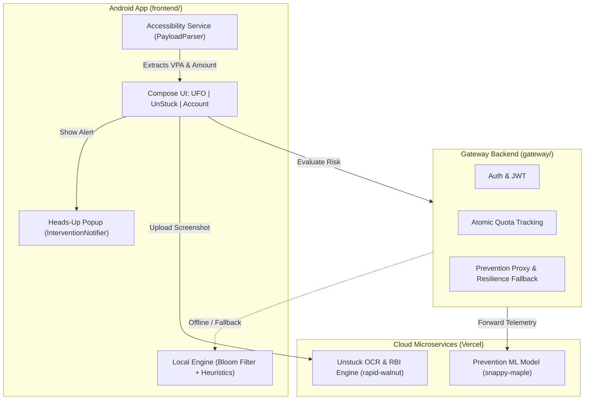

# 🛸 UFO (Universal Fraud Observer) + UnStuck — Release Information

> **Version:** `1.0.0` (Hackathon Release)  
> **Package Name:** `com.ufo.fraudobserver`  
> **APK Binary:** [`dist/UFO-demo.apk`](file:///b:/UnStuck/dist/UFO-demo.apk) (also in [`frontend/app/build/outputs/apk/demo/release/app-demo-release.apk`](file:///b:/UnStuck/frontend/app/build/outputs/apk/demo/release/app-demo-release.apk))  
> **Target OS:** Android 8.0 (API 26) through Android 15 (API 35)

---

## 📌 Executive Summary

**UFO + UnStuck** is an end-to-end financial protection suite designed for the Indian UPI ecosystem:
1. **PREVENTION (UFO Guard):** Intercepts payment screens in real time *before* the user enters their UPI PIN, extracts recipient VPAs and transaction amounts, queries machine learning and blacklist intelligence, and renders an instant Truecaller-style heads-up alert with risk scoring (0–100) and clear verdicts (*Likely Safe*, *Be Careful*, or *Likely Scam*).
2. **RESOLUTION (UnStuck):** For failed or stuck payments (money debited but beneficiary not credited), users upload a screenshot. AI extracts transaction parameters (UTR, date, amount, bank), tracks statutory **RBI TAT (Turn Around Time)** deadlines, computes accrued penalty compensation (**₹100/day** under RBI Circular DPSS.CO.PD No.629/02.01.014/2019-20), and drafts formal legal notices for the Bank Grievance Cell, Nodal Officer, and RBI Ombudsman.
3. **ACCOUNT & ACCESS:** Manages user identity, quotas (100 free Prevention checks, 5 free Unstuck cases), entitlements, and demo presentation controls.

---

## 🏛️ Project Architecture & Sub-Groups



---

### 1. Android Frontend (`frontend/`)
- **Technology Stack:** Kotlin, Jetpack Compose, Material3, Coroutines, Flow, Retrofit2, Room Database.
- **Accessibility Service (`UfoAccessibilityService`):**
  - Uses Breadth-First Search (BFS) to traverse UPI app windows (Google Pay, PhonePe, Paytm, BHIM, CRED, Amazon Pay).
  - Strictly ignores PIN entry fields, password fields, and hidden views to guarantee user privacy.
  - Prioritizes editable input fields (`isEditable` / `EditText`) to extract the exact amount entered by the user, while filtering out account balances, credit limits, and cashback advertisements.
  - Enforces a 5-second deduplication debounce window per `(vpa, amount, app)` to prevent alert flooding.
- **Truecaller-Style Heads-Up Notification (`InterventionNotifier`):**
  - Renders a non-blocking floating card over the active UPI app with risk badge, merchant name, VPA, amount, and an "Abort Transaction / View Details" action button.
- **On-Device Fallback Engine (`RiskEvaluator`):**
  - Includes an embedded local Bloom filter with known high-risk handles and heuristic rule evaluation (velocity checks, high-value limits, scam handle matching).
  - Operates with sub-15ms latency even in offline or airplane mode.
- **Unstuck Resolution Module (`feature/unstuck`):**
  - Multimodal screenshot scanner and review screen with pre-filled transaction parameters.
  - Statutory deadline engine and live penalty counter calculating ₹100/day compensation beyond T+1 / T+5 days.
  - Multi-tier formal escalation ladder: Bank Grievance Ticket ➔ Principal Nodal Officer ➔ RBI Ombudsman (CMS Portal integration).

---

### 2. Gateway Backend (`gateway/`)
- **Technology Stack:** FastAPI, SQLAlchemy, SQLite (production-compatible with PostgreSQL), Pydantic v2 Settings.
- **Authentication & Security:** JWT tokens with HS256 algorithm, 15-minute access token lifespan, 30-day refresh tokens.
- **Atomic Quotas:** Server-enforced limits (100 free checks, 5 free cases). Client applications can never fabricate entitlements or bypass quotas.
- **Resilient Upstream Proxy:**
  - Upstream endpoint: `https://temporary-snappy-maple-v2pe7o5-n4c5fhzfe-anon-delta-flame.vercel.app`
  - If upstream ML is cold or unreachable, the gateway executes embedded heuristic and blacklist analysis so payment safety checks never fail.

---

### 3. Deployed Unstuck Backend (`unstuck_backend/`)
- **Live Endpoint:** `https://temporary-rapid-walnut-8b8urq6-erhjg3k0f-anon-mu-indol.vercel.app`
- **Capabilities:**
  - Multimodal Gemini vision OCR for payment receipts and SMS parsing.
  - Normalization of 12-digit UPI UTRs, timestamps, banks, and transaction statuses.
  - Rule-based evaluation against RBI circulars (`rules.json`) and bank grievance directory (`banks.json`).
  - Automated PDF escalation notice generation.

---

## 📱 Installation & Setup Instructions

### Prerequisites
- Any physical Android device or Android Studio Emulator running **Android 8.0 (Oreo / API 26) or higher**.

---

### Step 1: Install the APK
Download [`UFO-demo.apk`](file:///b:/UnStuck/dist/UFO-demo.apk) and install via one of these methods:
- **Direct Phone Download:** Transfer/download the APK to your phone and open it from your file manager.
- **Command Line (ADB):**
  ```powershell
  adb install -r -g "B:\UnStuck\dist\UFO-demo.apk"
  ```

---

### Step 2: Google Play Protect Notice
Because this APK is built for testing/hackathon demonstration and signed with a development key, Google Play Protect may display a prompt:
1. Tap **"More details"** (or *Details*).
2. Tap **"Install anyway"** (or *Run anyway*).

---

### Step 3: Enable Permissions (Android 13, 14 & 15)
To allow UFO to monitor payment screens in real time:

#### A. Unlock Restricted Settings (Required on Android 13+)
1. Open your phone's **Settings** ➔ **Apps** ➔ **UFO Demo**.
2. Tap the **3 vertical dots (`⋮`)** in the top-right corner.
3. Tap **"Allow restricted settings"** and confirm your fingerprint or PIN.

#### B. Turn On Accessibility & Notifications
1. Go to **Settings** ➔ **Accessibility** ➔ **UFO UPI Guard**.
2. Switch the toggle to **ON**.
3. Open the **UFO Demo** app and allow notifications when prompted.

---

## 🧪 How to Demo / Test the App

### 1. In-App Live Verification (No External Apps Needed)
1. Open **UFO Demo** and navigate to the first tab (**UFO**).
2. Scroll to the **"Live Test & Custom Amount Verification"** card.
3. Enter any custom VPA (e.g. `prize.winner99@ybl`) and any Amount (e.g. `₹1,500`).
4. Tap **"Trigger Popup with ₹[amount]"**.
5. The Truecaller-style heads-up alert will appear with the **exact, matching amount** and risk verdict.
6. Alternatively, click any of the preset buttons:
   - **Safe ₹250** (`swiggy@icici` ➔ 0% Risk)
   - **Warn ₹5k** (`prize.winner99@ybl` ➔ 50% Risk)
   - **Scam ₹50k** (`cbi.digitalarrest@ybl` ➔ 95% Risk)

### 2. Live UPI Payment Test (Google Pay, PhonePe, Paytm, BHIM)
1. Open any UPI application on the device.
2. Initiate a payment or scan a QR code.
3. On the payment confirmation screen where the receiver and amount are visible, UFO will automatically trigger the safety alert banner before PIN entry.

### 3. Unstuck Dispute Resolution Test
1. Tap the **Unstuck** bottom navigation tab.
2. Tap **"Scan Failed Payment Receipt"** and select a payment screenshot (or click the sample founder demo case).
3. Review extracted details (amount, bank, UTR, failure timestamp).
4. View the statutory RBI turnaround deadline and accrued penalty compensation counter.
5. Tap **"Draft Legal Notice & Escalation Ladder"** to view ready-to-share complaints for the bank and RBI Ombudsman.

---

## 🔒 Security & Compliance Safeguards

- **Zero Credential Transmission:** The app never inspects, captures, or transmits passwords, OTPs, or UPI PINs.
- **Strict Package Whitelisting:** Screen scanning is activated only on official, allowed UPI payment package namespaces.
- **Privacy First:** Extracted screen context is stripped of PII before telemetry logging.
- **Client-Decoupled Quotas:** Free limits and subscription entitlements are verified server-side.

---

*Compiled for Hackathon Submission — UFO & UnStuck Engineering Team.*

